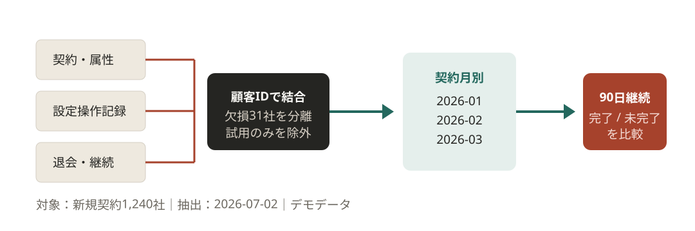
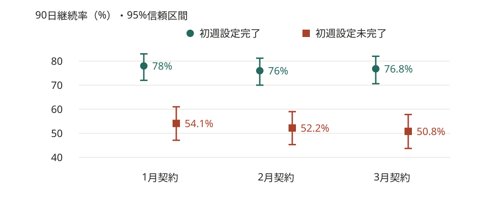
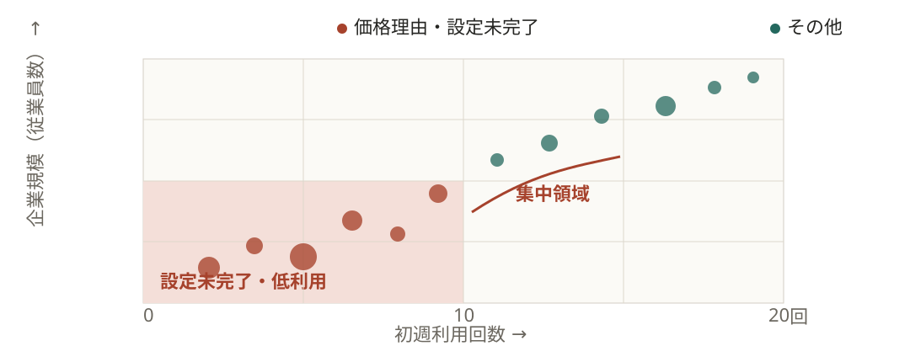
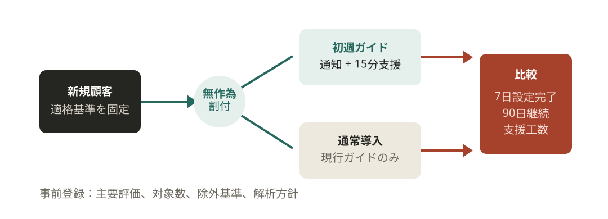

<!-- _class: read-ahead cover -->
<!-- _paginate: false -->

# 初週設定を終えた顧客は、継続率が高い

## 2026年第2四半期 解約分析

初週設定＝契約後7日以内の初期設定。
継続率＝契約した顧客のうち、90日後も利用している割合。

---

<!-- _class: read-ahead diagram dense compact-visual -->

# 同じ契約月の顧客で、設定完了と継続率を比べた

対象：2026年1〜3月の新規契約1,240社（試用除外） ／ 設定操作記録の欠損31社は主分析から分離
出典：デモ顧客データ辞書 v2026-06、抽出日 2026-07-02

---

<!-- _class: read-ahead chart compact-visual -->

# 継続率の差は、各月で約24〜26ポイント

例：1月は78%と54.1%で、差は23.9ポイント。線は推定の幅（95%信頼区間）。
設定を終えたことが継続の原因だとは、まだ言えない。

---

<!-- _class: read-ahead chart compact-visual -->

# 価格に不満がある顧客も、初週の利用が少ない

読み方：色の付いた領域に注目。価格への不満と設定の停滞は重なっており、値下げだけで解決するとは言えない。

---

# 関連は見えた。支援の効果は、まだ分からない

| 層 | この分析から言えること | まだ言えないこと |
|---|---|---|
| 事実 | 初週設定完了群の継続率が高い | 設定完了が継続を生む |
| 解釈 | 初期導入の停滞が早期離脱の兆候 | 価格が無関係である |
| 仮説 | 7日以内の支援で設定完了が増える | 施策の費用対効果 |

> 判断境界：支持するのは初週支援の**検証優先度**まで。施策効果と投資対効果は未検証。

---

<!-- _class: read-ahead dense -->

# 設定だけが原因とは言えない、4つの理由がある

| 限界 | 影響 | 次の対処 |
|---|---|---|
| 自走できる顧客ほど設定を完了 | 効果を過大評価する可能性 | 無作為化した支援実験 |
| 操作記録の欠損31社 | 完了率の誤分類 | サーバーログとの突合 |
| 90日追跡のみ | 長期継続を説明できない | 180日指標を継続観測 |
| 価格回答は自己申告 | 理由の単純化 | 面談対象で補完 |

> 解釈上の上限：4つの限界が残るため、現時点では関連の再現性を示せても因果効果は断定できない。

---

<!-- _class: read-ahead diagram compact-visual -->

# くじ引きで2群に分け、初週支援の効果を測る

主要評価：7日設定完了率 ／ 副次評価：90日継続率、支援工数

---

<!-- _class: read-ahead closing -->

# 次に試すのは、最初の7日の設定支援

設定を終えた顧客ほど継続している。ただし、支援の効果は未確認。

支援あり・なしで比較し、継続率が上がるかと支援の手間を確かめる。
