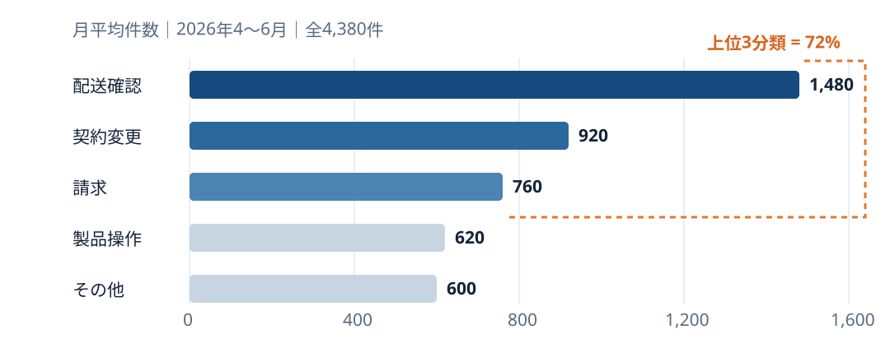
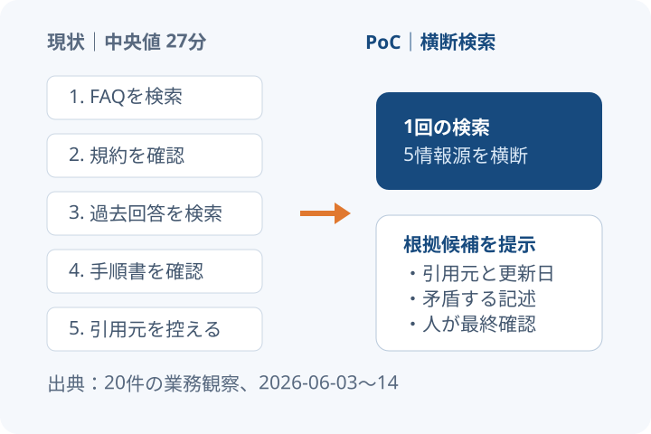
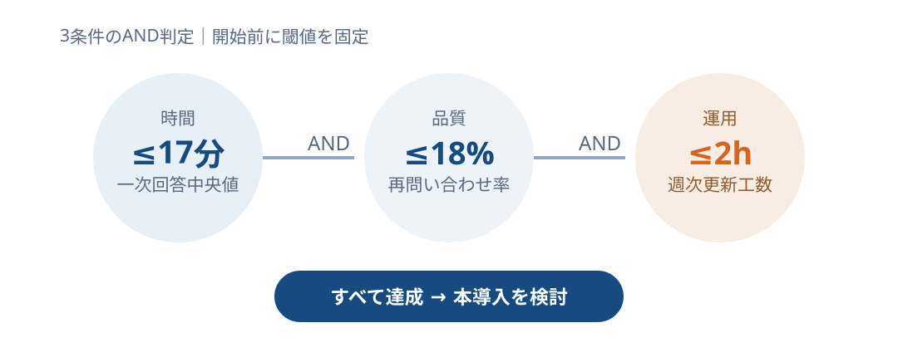
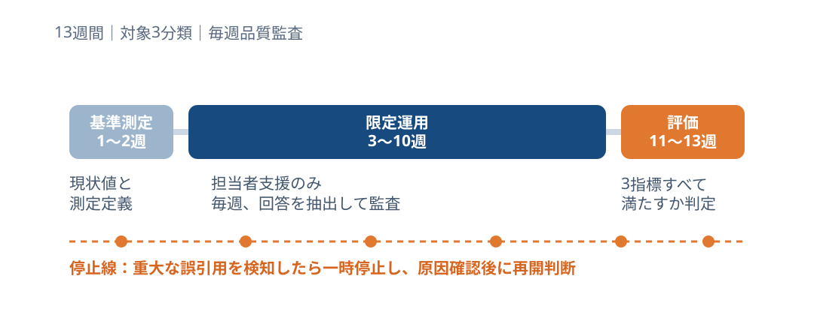

<!-- _class: hybrid cover -->
<!-- _paginate: false -->

# 300万円・90日で、回答の準備時間を減らせるか試す

## 問い合わせ担当者を支援する小規模な試行

PoC（実証実験）：本格導入の前に、効果と安全性を確かめる。

<!--
本日の判断は全面導入ではありません。90日で効果と運用負荷を測る限定PoCの可否です。
-->

---

# 承認してほしいのは、90日・上限300万円の試行

| 判断項目 | 推奨 | 境界条件 |
|---|---|---|
| 対象 | 配送確認・契約変更・請求 | 個人情報を含む回答は対象外 |
| 期間 | 90日 | 最初の2週は基準測定 |
| 予算 | 300万円上限 | 追加開発は再承認 |
| 本導入判定 | 時間・品質・運用負荷 | 3指標すべてを満たす |

> 成功しても自動応答へは進まず、担当者支援の有効性だけを判定する。

<!--
判断境界を先に合意し、PoC中のスコープ拡大を防ぎます。
-->

---

<!-- _class: hybrid chart -->

# 3種類に絞っても、問い合わせの約7割を対象にできる

<!--
2026年4〜6月の月平均です。分類は受付時の主分類を使い、重複計上はありません。
-->

---

<!-- _class: hybrid diagram -->

# 回答までの34分中、27分は情報探しに使っている

<!--
時間は20件の業務観察の中央値です。速度だけでなく引用の妥当性も測ります。
観測は探索27分、回答作成7分。生成そのものより根拠候補の検索に改善余地があると解釈し、PoCは引用元を残す検索支援に限定します。
-->

---

# まず小さく試し、効果を確かめてから導入を決める

| 選択肢 | 効果を測れるか | 初期費用 | 誤回答への備え | 中止しやすさ |
|---|---:|---:|---:|---:|
| 現状維持 | 低 | 0 | 現状同等 | 高 |
| **限定PoC** | **高** | **300万円** | **人が確認** | **高** |
| 全面導入 | 中 | 1,800万円〜* | 自動化範囲次第 | 低 |

\* 仮説レンジ。正式見積ではなく、比較のための初期想定。

<!--
全面導入費は未確認です。ここで承認を求める数字ではないため、仮説レンジと明示しています。
-->

---

<!-- _class: hybrid chart -->

# 続ける条件は、回答の速さ・正確さ・維持の手間の3つ

3条件すべてを満たすこと。速くなっても、品質が悪化すれば継続しない。

<!--
速度が改善しても品質が悪化すれば不採用です。開始前にこのゲートを固定します。
-->

---

<!-- _class: hybrid diagram -->

# 最初に現状を測り、試して、90日後に続けるか決める

誤った根拠の引用が重大な影響を招いた場合は、1件でも一時停止する。

<!--
重大な誤引用が1件でも確認された場合は一時停止し、原因分析後に再開可否を判断します。
-->

---

<!-- _class: hybrid closing -->

# 本日のお願い：上限300万円・90日の試行を承認ください

対象：配送確認・契約変更・請求。回答は担当者が確認する。

90日後：速さ・正確さ・維持の手間を評価し、継続を判断する。

<!--
承認後5営業日以内に、対象部門と計測定義を確定します。
-->
