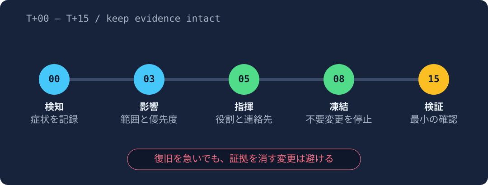
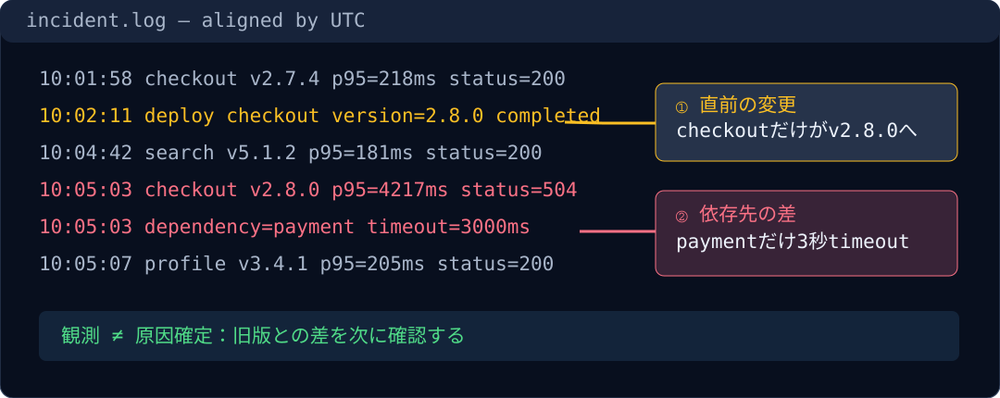
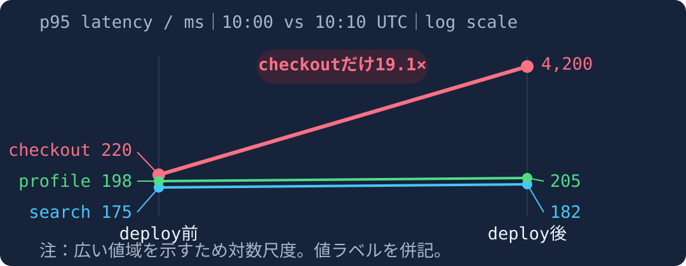
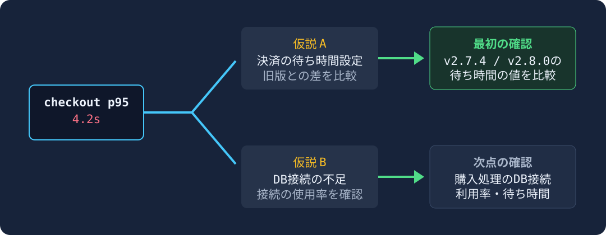

<!-- _class: hybrid cover -->
<!-- _paginate: false -->

# 障害対応は、事実を集めて原因を絞る

## 新人のサービス運用担当者向け・20分の研修

観測＝見えた事実。仮説＝原因の候補。検証＝候補を確かめる確認。


<!--
今日は原因を当てる訓練ではなく、次の確認を選ぶ訓練です。
-->

---

# 今日の目標：事実と推測を分け、次の確認を1つ選ぶ

1. 症状の時刻・範囲・期待値を固定する
2. 変更履歴と依存関係から仮説を2つまで立てる
3. 片方を否定できる最小の確認を選ぶ

> 成功条件：演習で「仮説、確認、結果による分岐」を90秒以内に書ける。

<!--
ツールの操作手順より、思考の順序を持ち帰ってください。
-->

---

<!-- _class: hybrid diagram -->

# まず「いつから・誰に・何が起きたか」を揃える



緊急の安全確保を優先しつつ、原因の証拠が消える変更は避ける。

<!--
安全上必要な緊急操作を除き、証拠を消す変更は避けます。
-->

---

<!-- _class: hybrid screenshot -->

# 更新後に、購入手続きだけでエラーが増えた



checkout＝購入手続き、payment＝決済。更新との時間的な重なりだけでは、原因は確定しない。

<!--
この時点ではdeployとの時間的関連だけで、原因確定ではありません。
-->

---

<!-- _class: hybrid chart compact-visual -->

# 購入手続きだけが遅くなり、他の機能はほぼ同じ



p95＝100回中95回が、この時間以内に応答する目安。購入手続きは0.22秒→4.2秒。
対数目盛なので、線の傾きではなく表示された数値を比べる。

<!--
対数尺度なので、線の傾きだけで差を読まず、必ず併記した実値を確認します。
searchとprofileはほぼ不変なので、全体的な計算資源不足という仮説とは整合しません。まずcheckout固有の変更と依存先を確認します。
-->

---

<!-- _class: hybrid diagram -->

# 決済の待ち時間設定を比べ、原因候補を減らす



<!--
複数設定を一度に変えると、どの仮説が正しかったか分からなくなります。
-->

---

<!-- _class: hybrid exercise -->

# 演習・90秒：次に何を1つ確認しますか？

```text
10:02 deploy checkout v2.8.0 completed
10:05 checkout p95=4200ms / 504=7.8%
10:05 search p95=180ms / 5xx=0.1%
10:06 payment dependency timeout=3.0s
```

504＝待ち時間超過のエラー。timeout＝応答を待つ上限時間。

回答：原因候補 → 確認するもの → 結果ごとの次の行動

<!--
90秒。復旧操作ではなく、まず確認を1つだけ選んでください。
-->

---

<!-- _class: hybrid closing -->

# 事実 → 原因候補 → 1つ確認。この順番を持ち帰る

演習の例：決済の待ち時間設定を、更新前と更新後で比べる。

変わった → 値とエラーの関係を調べる。
変わらない → 別の候補を確かめる。操作と結果は時刻付きで残す。

<!--
演習の推奨回答は、旧版と新版のpayment呼び出しtimeout値を比較する、です。
-->
